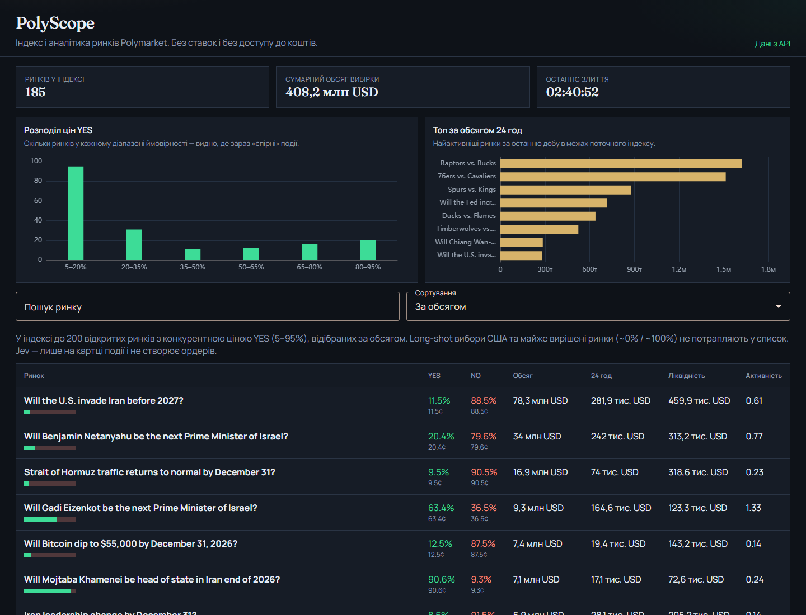
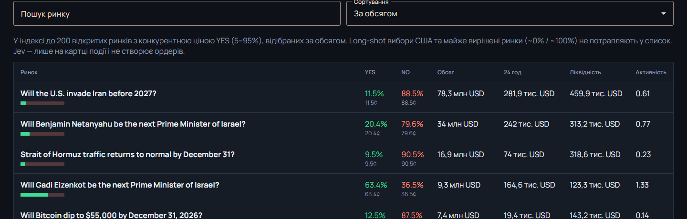
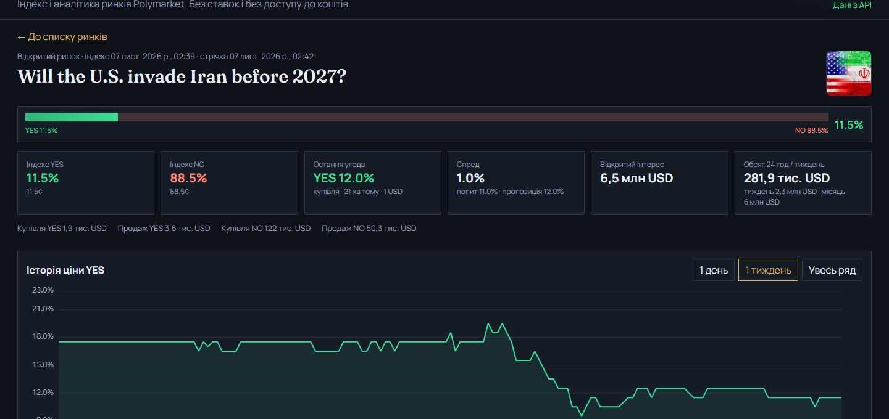
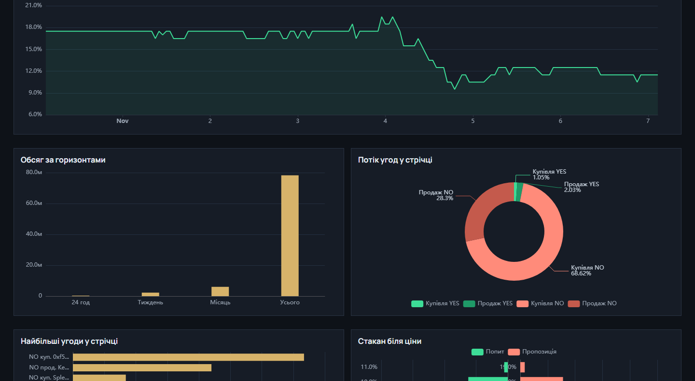
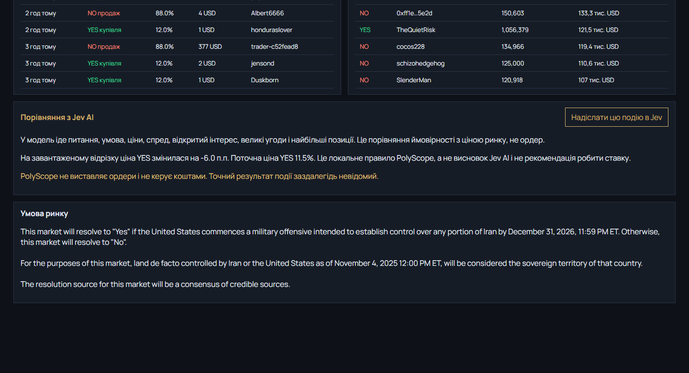
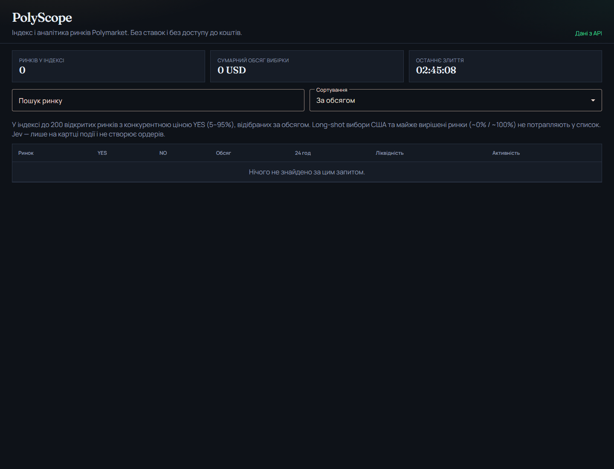

# PolyScope

**Індексація та аналітика ринків Polymarket — без ставок і без доступу до коштів.**

Клієнтський SPA на Angular: публічні Gamma / CLOB / Data API → нормалізація → in-memory індекс → графіки й картка події. Опційно — дорадчий висновок Jev AI через локальний проксі.

[](https://angular.dev)
[](https://www.typescriptlang.org/)
[](https://echarts.apache.org/)
[](#)

<p align="center">
  
</p>

<p align="center"><em>Головний екран: оглядові діаграми та індекс до 200 відібраних відкритих ринків</em></p>

---

## Навіщо це

Офіційний інтерфейс Polymarket заточений під торгівлю. PolyScope — під **дослідження й аналітику**:

| Потрібно досліднику | Що робить PolyScope |
| --- | --- |
| Швидко побачити активні конкурентні ринки | Індекс за обсягом, YES у діапазоні 5–95% |
| Порівняти ціну, обсяг, ліквідність | Таблиця + сортування + пошук у вибірці |
| Подивитись динаміку однієї події | Історія YES, угоди, книга, тримачі, OI |
| Оновити котирування «наживо» | CLOB WebSocket, лише за вузького спреду ≤ 0,05 |
| Отримати дорадчу оцінку ІІ | Локальний проксі Jev AI (ключ не в браузері) |

**Чого немає навмисно:** ордерів, гаманця, торгового SDK, серверної БД, повного каталогу всіх ринків.

---

## Можливості

### Список ринків
- До **200** відкритих ринків після відбору
- Оглядові діаграми: розподіл цін YES і топ за обсягом 24h
- Пошук і сортування (обсяг, 24h, ліквідність, ціна YES)

<p align="center">
  
</p>

### Картка події
- YES / NO, спред, відкритий інтерес, обсяги
- Графік історії ціни (день / тиждень / увесь ряд)
- Суміжні діаграми: потік угод, книга заявок, тримачі

<p align="center">
  
</p>

<p align="center">
  
</p>

### Живе котирування і Jev AI
- REST-оновлення картки + WebSocket mid-price, якщо спред реальний
- Кнопка «Надіслати в Jev» на одній події → окремий платний виклик
- Немає кредитів / ключа → чесна помилка, без вигаданої ймовірності

<p align="center">
  
</p>

### Стани помилок
Якщо Gamma / мережа недоступні — повідомлення і повторне завантаження.

<p align="center">
  
</p>

---

## Архітектура

```text
┌────────────────────┐     REST      ┌─────────────────────────┐
│  Angular SPA       │◄─────────────►│  Gamma / CLOB / Data API │
│  (браузер)         │               └─────────────────────────┘
│                    │     WS        ┌─────────────────────────┐
│  MarketStore       │◄─────────────►│  CLOB WebSocket          │
│  LiveFeed          │               └─────────────────────────┘
│  ECharts UI        │
└─────────┬──────────┘
          │ POST /api/jev  (тільки localhost)
          ▼
┌────────────────────┐     HTTPS     ┌─────────────────────────┐
│  Node proxy :8787  │──────────────►│  Jev AI                  │
│  JEV_API_KEY у .env│               └─────────────────────────┘
└────────────────────┘
```

**Правило індексу** (`market-index.ts`):

1. Відкриті ринки з Gamma (кілька сторінок за `volumeNum`)
2. Кандидат: не closed, YES ∈ **[0.05; 0.95]**, без long-shot шуму US election
3. Сортування за обсягом → зріз **топ-200** у `Map` у пам’яті вкладки

---

## Стек

| Шар | Технології |
| --- | --- |
| UI | Angular 19, Angular Material, RxJS |
| Графіки | Apache ECharts (`ngx-echarts`) |
| Дані | Gamma API, CLOB REST/WS, Data API |
| ІІ (опційно) | Node.js проксі → Jev AI |
| Мова | TypeScript 5.7 |

---

## Швидкий старт

**Вимоги:** Node.js 20+, npm.

```bash
git clone https://github.com/Dast1n0k/PolyScope.git
cd PolyScope
npm install
```

### 1. Клієнт (достатньо для списку й карток)

```bash
npm start
```

Відкрийте [http://127.0.0.1:4200](http://127.0.0.1:4200).

### 2. Проксі Jev AI (опційно)

Створіть `server/.env` (файл у `.gitignore`):

```env
JEV_API_KEY=ваш_ключ_з_jev-ai.pro
# JEV_PROXY_PORT=8787
```

У другому терміналі:

```bash
npm run proxy
```

Проксі слухає лише `127.0.0.1:8787`. Ключ **не** потрапляє в бандл Angular.

---

## Скрипти

| Команда | Що робить |
| --- | --- |
| `npm start` | `ng serve` + proxy.conf на Jev |
| `npm run proxy` | Локальний Node-проксі Jev AI |
| `npm test` | Unit-тести (Karma / Jasmine) |
| `npm run build` | Production-збірка |

---

## Структура репозиторію

```text
PolyScope/
├── src/app/
│   ├── core/                 # API, індекс, store, live-feed, Jev-клієнт
│   │   ├── polymarket-api.service.ts
│   │   ├── market-store.service.ts
│   │   ├── market-index.ts
│   │   ├── live-feed.service.ts
│   │   └── jev-insight.service.ts
│   └── pages/                # Список і картка ринку + графіки
├── server/
│   ├── proxy.mjs             # Jev AI proxy
│   ├── jev.mjs
│   └── .env.example
├── docs/readme/              # Скріншоти для цього README
└── proxy.conf.json           # /api/jev → localhost:8787
```

---

## Обмеження прототипу

- Не весь каталог Polymarket — лише відібрана вибірка до 200 ринків
- Індекс живе в пам’яті вкладки (без IndexedDB / серверної БД)
- Немає ордерів і метрик навантажувального тестування
- Jev AI — дорадчий модуль; це **не** інвестиційна порада і не сигнал на ставку

---

## Джерела даних

- [Polymarket Docs — Markets & Events](https://docs.polymarket.com/concepts/markets-events)
- [Prices & Orderbook](https://docs.polymarket.com/concepts/prices-orderbook)
- [API overview](https://docs.polymarket.com/getting-started/api)
- [Real-Time Data](https://docs.polymarket.com/market-data/realtime-data-socket)
- [Gamma API](https://gamma-api.polymarket.com)

---

## Автор

Кваліфікаційна робота магістра, спеціальність **121 Інженерія програмного забезпечення**  
ДТЕУ · Дмитро Судницин · 2026

Репозиторій: [github.com/Dast1n0k/PolyScope](https://github.com/Dast1n0k/PolyScope)
